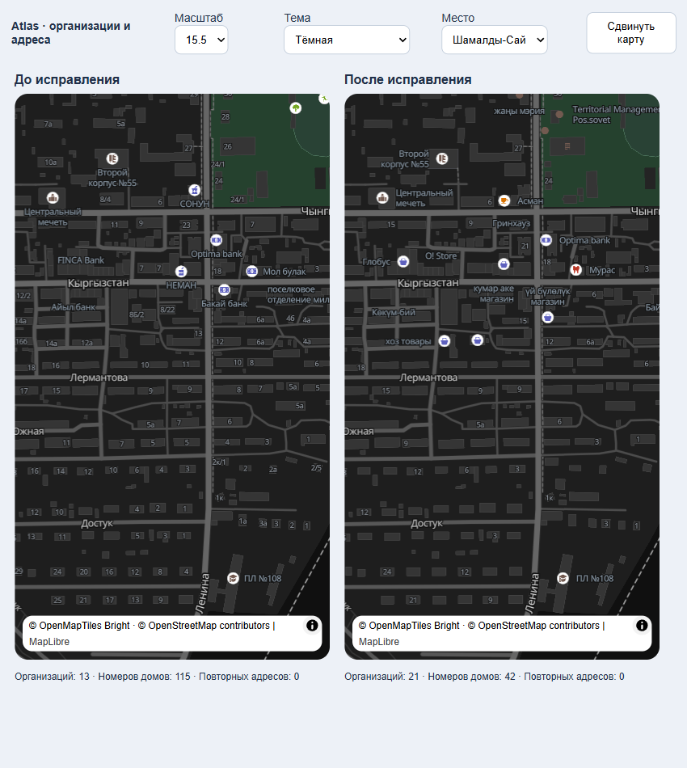
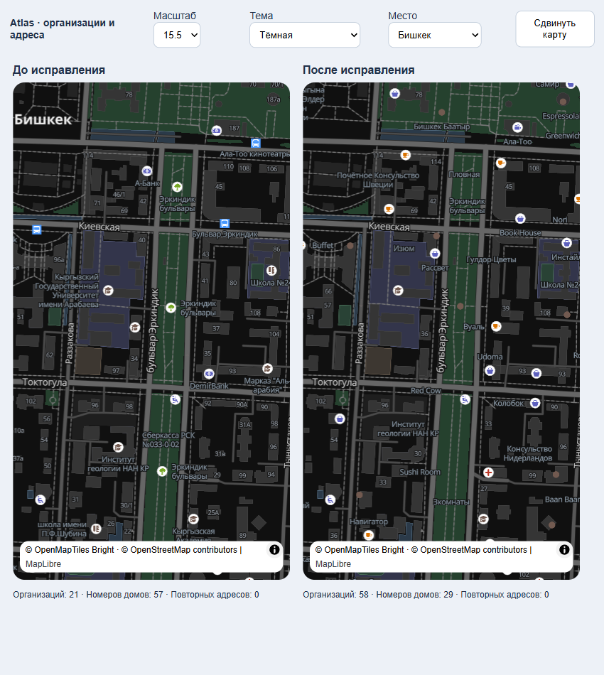

# Подписи улиц, адреса и организации

Проверка выполнена 15 октября 2026 года на реальном рендерере MapLibre GL JS 5.9.0 с полным стилем приложения, плитками OpenFreeMap/Shortbread и двумя областями карты по 390 × 700 CSS-пикселей.

## Изменения

- Интервал названий основных улиц: 420 пикселей на обзоре и 360 при приближении; местных улиц — 300 вместо 180–200. Начальные 480 пикселей при приближении отклонены после проверки: в Шамалды-Сае название Кыргызстан пропадало за краем экрана.
- Отступ столкновений дорожных подписей — 5 пикселей. Проверка столкновений включена; подписи сохраняют своё место и читаемую ориентацию. Местные улицы появляются с прежних масштабов 13/14.
- В дорожных подписях убраны только общие слова: начальные «улица », «ул. », конечные « улица» и « көчөсү». Проспекты, переулки, бульвары и имена организаций сохраняются. Смена языка работает и для сокращённых названий.
- Номера домов появляются с 15.5: 9 пикселей, с плавным увеличением до 10 на масштабе 16 и 11.5 на 18. Улицы сохраняют приоритет при размещении.
- До масштаба 16 показываются основные ориентиры: банки, медицинские учреждения, школы, аптеки, парки и другие выбранные категории. Обычные магазины и кафе появляются с 16. Ночные подписи организаций менее контрастны, чем улицы.

## Проверка рендерера

Проверен 21 сценарий: Шамалды-Сай на масштабах 13.5, 14.5, 15.5, 17 и 18; Бишкек на 15.5 и 17; светлая и тёмная темы с русскими названиями и тёмная тема с кыргызскими названиями. Все карты завершили загрузку, список ошибок MapLibre пуст.

Примеры для русских названий; число улиц означает число различных названий в запросе отображаемых объектов, а не число повторённых текстовых якорей:

| Область и масштаб | Различных улиц до → после | Номеров домов до → после |
| --- | --- | --- |
| Шамалды-Сай 13.5 | 5 → 7 | 0 → 0 |
| Шамалды-Сай 14.5 | 12 → 12 | 0 → 0 |
| Шамалды-Сай 15.5 | 7 → 6 | 0 → 114–115 |
| Шамалды-Сай 17 | 4 → 4 | 25 → 24 |
| Шамалды-Сай 18 | 1 → 1 | 8 → 8 |
| Бишкек 15.5 | 7 → 6 | 0 → 57 |
| Бишкек 17 | 2 → 2 | 3 → 3 |

В Шамалды-Сае на 15.5 подпись Токтосуна Сыдыкова у нижнего края уступает место при проверке столкновений; на кыргызском языке в этой области остаются все семь названий. Отдельные подписи у краёв экрана могут исчезать при сдвиге карты. Сокращение повторов не означает обязательного отображения каждой улицы в любой области.

Выражения сокращения дополнительно вычислены самим MapLibre для «улица Ленина», «Улица Южная», «ул. Лермонтова», «Ленин көчөсү» и неизменяемых «проспект Чуй», «Северный переулок», «Көчөсү жок», «Ленина». Native 11.12.1, используемый приложением, поддерживает необходимые операции `slice`, `downcase`, `let` и `case`: [спецификация выражений](https://maplibre.org/maplibre-style-spec/expressions/#slice).

Проверка столкновений между источниками включена по умолчанию в [MapOptions точной версии Native](https://github.com/maplibre/maplibre-native/blob/android-v11.12.1/include/mbgl/map/map_options.hpp#L68). Обёртка React Native 10.4.2 не предоставляет отдельного свойства для её переключения; в браузерной проверке явно задано `crossSourceCollisions: true`.

Две целевые проверки карты и переключения темы/языка проходят. Это проверка браузерного рендеринга, а не физического Android-устройства. Растровый резервный источник содержит уже нарисованные поставщиком подписи и не управляется этими правилами.

## Уточнение баланса организаций и номеров домов

По следующему замечанию пользователя плотность изменена повторно: прежний вариант слишком сильно отдавал место номерам домов. Приведённые выше числа описывают предыдущую итерацию.

| До | После | Зачем |
| --- | --- | --- |
| Обычные организации скрыты до масштаба 16 | Организации с названием доступны с 14.5; остальные с 16 | Вернуть магазины, кафе и другие полезные места на обзор |
| Номера заполняли почти все здания | На обзорном масштабе номера размещаются реже, при приближении плотность растёт | Не превращать карту в сплошные адреса |
| В плотном центре организации могли вытеснить все адреса | Небольшая часть номеров получает место перед организациями, остальные заполняют промежутки | Сохранять обе категории в разных типах районов |

Предварительный адресный слой действует только с 15.5 до 16.5 и выбирает числовые номера, кратные трём. Он не удаляет остальные адреса: они остаются в основном слое и появляются в свободных местах. С 16.5 этот дополнительный приоритет отключается. Обе адресные группы используют один источник, одинаковое оформление и общие столкновения; проверка отображённых координат не обнаружила двойных адресных подписей. Названия улиц сохраняют высший приоритет. Геометрия зданий не менялась.

Проверено 15 сценариев реального рендеринга в Шамалды-Сае и Бишкеке: масштабы 14.5–17, обе темы и кыргызские подписи. Все карты загрузились без ошибок MapLibre. В сравниваемых областях количество различных названий улиц сохранилось.

Примеры при масштабе 15.5, русские подписи; числа относятся к объектам в текущей области, а не к обязательной пропорции для любой карты:

| Область | Организаций до → после | Номеров домов до → после |
| --- | --- | --- |
| Шамалды-Сай | 13 → 21 | 115 → 42 |
| Бишкек | 21 → 58 | 57 → 29 |

Проверка TypeScript и две целевые проверки стиля прошли. Обновлённый стиль пока находится в проекте; APK не пересобран, проверка на физическом Android не выполнена.
