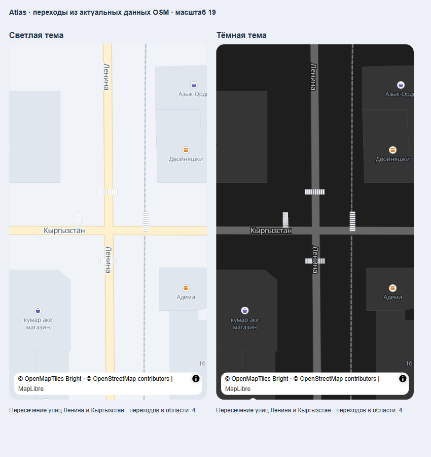
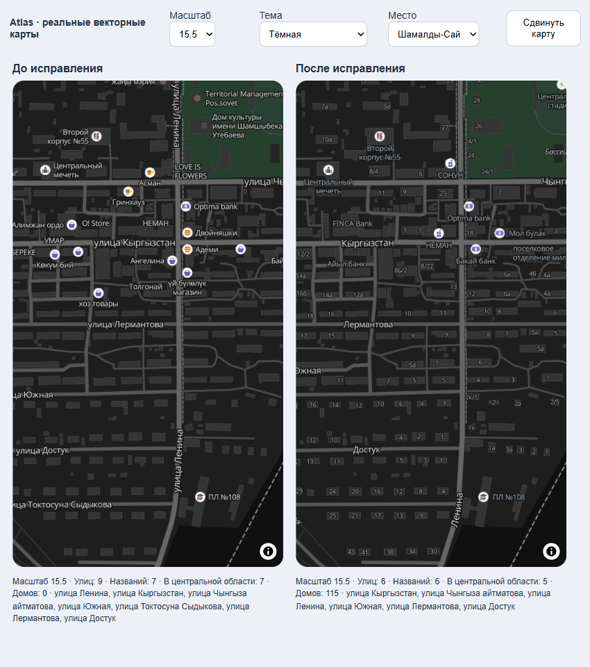

# Карта и навигация: переходы, камеры, скорость и манёвры

Первоначальная версия выпущена в 1.2.31; см. `map-navigation-release-1.2.31.md`. Уточнения ниже пока находятся в исходном коде и локальном снимке OSM.

Последующее серверное исправление уже опубликовано: см. `map-road-feature-freshness.md`. Оно устраняет повторное появление старого фильтра, обновляет исходные данные и добавляет проверку свежести переходов/светофоров.

## Уточнение отображения после 1.2.31

По уточнённому запросу карта показывает только пешеходные переходы и самостоятельно размеченные светофоры `highway=traffic_signals`. Теги `crossing=traffic_signals`, `crossing=pedestrian_signals` и `crossing:signals=yes` у перехода больше не создают отдельную иконку светофора. Камеры и ограничения скорости сохранены в навигационных предупреждениях, но исключены из карты на сервере и в фильтре приложения.

Для переходов и светофоров снят общий лимит 2 000 объектов в области; близкие самостоятельные светофоры больше не объединяются в радиусе 12 м (осталось удаление совпадений ближе 3 м). Минимальный масштаб отображения снижен с 14.5 до начального 14; переходы без определённого направления также доступны с 14. Ошибка повторного запроса не очищает уже показанные объекты.

Сверка исходного PBF со снимком выявила один пропущенный узел с `footway=crossing` без `highway`. Обработчик исправлен, снимок пересобран: 6 262 объекта. Геометрия дорожных ограничений и камер для предупреждений сохранена. Неразмеченные в OSM переходы не создаются автоматически.

Звезда «Избранное» на главном экране использует цвет соседних кнопок: `#1267B5` в светлой теме, `#FFFFFF` в тёмной. Звёзды рейтинга сохраняют `#FFBE12`. Проверено исполнением настоящего компонента `Icon` с обеими палитрами.

Проверки: 37 серверных тестов, Python-тест извлечения, серверная сборка и TypeScript приложения прошли. Проверка плотной области включает 2 100 переходов и два самостоятельных светофора на расстоянии 8 м. Регрессионные тесты карты проверяют отсутствие знаков и отображение переходов на масштабе 14. Полный набор map-selection во время параллельных изменений маркера имеет отдельное падение в проверке anchor конечной точки (`0.9375 !== 1`); код маркера в рамках этого уточнения не менялся.

## Причины

Карта принимала только `traffic_light` и `pedestrian_crossing`, исключая камеры и ограничения скорости. Генератор дорожных объектов обрабатывал узлы, но пропускал переходы, размеченные линиями, камеры из отношений OSM и ограничения `maxspeed` на дорогах. Часть переходов удалялась из карты из-за слишком строгого требования дорожной привязки. Отдельный вид ограничения был жёстко задан как `speed_limit_60`.

В навигации направленные манёвры OSRM `continue`, `new name`, `notification` превращались в движение прямо. Экран скрывал настоящий манёвр дальше 100 м, а предварительная озвучка независимо от данных маршрутизатора говорила «Продолжайте движение прямо».

Окно дорожных предупреждений равномерно пересэмплировало маршрут через 20 м, срезая настоящие углы перекрёстков. Это могло изменить направление участка и привести к отклонению предупреждений на своей дороге.

## Результат

| До | После | Для чего |
| --- | --- | --- |
| Камеры отсутствовали в карте | Камеры из узлов и отношений OSM доступны карте и предупреждениям | Показывать реальные радары |
| Переходы без точной привязки скрывались | Все размеченные переходы сохраняются; направление берётся из дороги или геометрии перехода | Показывать обычные и регулируемые переходы |
| Маленькая растровая разметка | Векторная зебра с направлением дороги, читаемыми полосами и размером по масштабу | Приблизить оформление к предоставленным примерам |
| Единственный лимит 60 | Числовой `speedLimit` и границы участка `along`/`endAlong` | Показывать фактическое ограничение |
| Настоящий манёвр скрыт до 100 м | Текст и стрелка показывают предстоящий манёвр заранее | Готовиться к повороту |
| Направленный `continue` озвучивался как прямо | Плавные, обычные и крутые повороты сохраняют сторону и крутизну | Использовать информацию маршрутизатора |
| Названия повторялись через 180–200 px | Интервалы 300–420 px, компактные названия, отступы столкновений 5 px | Снизить повторы и наложения |
| На масштабе 15.5 много организаций и нет адресов | Номера домов с 15.5; обычные магазины/кафе с 16 | Отделить улицы и адреса от организаций |

Снимок пересобран из локального PBF Кыргызстана: 6261 дорожный объект, включая 5088 переходов, 4849 дорог с ограничениями скорости и 4453 соседних дорожных сегмента для исключения ошибочного заимствования скорости с параллельной дороги. Добавлены 312 переходов, размеченных линиями. Для 13 переходов достоверное направление отсутствует: вместо выдуманной ориентации используется компактный знак.

Постоянный лимит в навигации берётся из конечного участка дороги и исчезает после выезда на участок с неизвестным ограничением. Одиночный знак остаётся предупреждением. Обновление окна сохраняет идентичность продолжающегося участка, предотвращая повторную озвучку того же лимита. Камеры предупреждаются за 500 м, ограничения за 250 м, остальные объекты за 150 м. В панели одновременно показываются до трёх ближайших типов предупреждений.

Предварительная озвучка теперь называет настоящий манёвр и расстояние, например «Через 450 метров плавно поверните направо». Напоминание за 100 м и команда непосредственно перед поворотом сохранены. Перед воспроизведением проверяются актуальные манёвр, маршрут, GPS и расстояние; это применяется в приложении и фоновом отслеживании. Русский TTS произносит также расстояния в тысячах метров, сохраняя числа в названиях улиц.

Семантика манёвров сверена с [OSRM StepManeuver](https://project-osrm.org/docs/v5.24.0/api/#stepmaneuver-object). Подробности проверки подписей и поддерживаемых выражений Native — в [отдельном отчёте](map-label-density-verification.md).

## Проверки

- `mobile`: `npm run test:navigation` — 119 проверок прошли, включая реальную цепочку ответа маршрутизатора → состояние навигации → текст/стрелка/вызов озвучки, устаревшие подсказки, фоновые обновления и дорожные окна.
- `mobile`: `node --test tests/map-selection.test.cjs tests/map-road-markings.test.cjs` — 53 проверки прошли: интеграция карты, камеры, ограничения и направления зебры. Дополнительно прошли проверки панелей заказа.
- `server`: `npx tsx --test test/road-features.test.ts test/maps.test.ts` — 35 проверок прошли, включая обычные переходы, камеры отношений, ограничения не 60, реальные данные, направления и соседнюю дорогу без известного лимита.
- `server`: Python-проверка генератора прошла: переход-линия, камера только из отношения, ширина/направление дороги и соседний сегмент.
- TypeScript мобильного приложения и сервера прошёл. Проверка пробелов не нашла ошибок.
- Реальный браузерный рендерер MapLibre с полным стилем приложения: 21 сценарий Шамалды-Сая и Бишкека, масштабы 13.5–18, обе темы и кыргызские подписи. Ошибок MapLibre нет.
- Переходы на масштабе 19 проверены в обеих темах: четыре зебры вокруг перекрёстка, по 10 полос на каждую. Использованы реальные объекты сервиса, а не придуманные позиции.

Это проверка исходного кода, поведения компонентов и браузерного рендеринга реальных плиток. На физическом Android эти изменения пока не проверены. Расстановка векторных подписей не управляет текстом, уже нарисованным поставщиком растрового резервного источника. При некоторых положениях карты название улицы может частично перекрывать векторную зебру: полигоны разметки не участвуют в столкновениях символов. Подписи улиц и адресов между собой участвуют в общей проверке столкновений.

## Уточнение положения и угла переходов

После визуального замечания переходы дополнительно привязаны к геометрии дорог, которая реально отображается в текущих векторных плитках. На проверенном перекрёстке Ленина/Кыргызстан два перехода были смещены примерно на 2 м относительно дороги из Shortbread. Разметка теперь проецируется на близкий дорожный сегмент и поворачивается по его локальному направлению. Пешеходные дорожки и железная дорога не используются для этой привязки; направление исходного перехода защищает от выбора перпендикулярной улицы на перекрёстке. Дальние объекты не переносятся, серверные точки предупреждений не меняются.

Проверены 56 тестов геометрии и интеграции карты, TypeScript и реальный рендеринг в обеих темах. На физическом Android уточнение пока не проверено.
