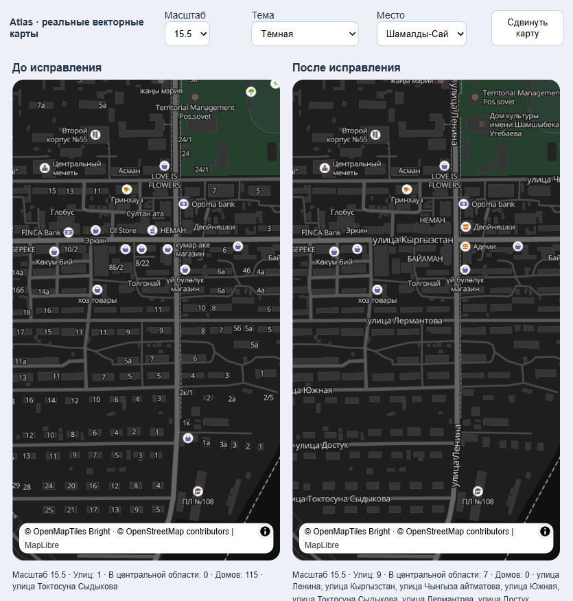

# Названия улиц — Atlas 1.2.17

Названия улиц теперь имеют приоритет перед номерами домов и подписями организаций. Изменение применяется к клиентскому и водительскому приложениям, в светлой и тёмной темах, с сохранением переключения языка.

## Причина

В прежнем стиле актуальные адреса и организации стояли выше названий улиц в списке слоёв. MapLibre размещает подписи в обратном порядке, поэтому эти объекты занимали свободное место первыми. Дополнительно номера домов появлялись уже на масштабе 14–15, а названия улиц повторялись с интервалом 360–480 пикселей, превышающим ширину большинства экранов телефонов. При приближении ближайшая подпись могла оказаться у края экрана.

Порядок размещения подтверждён исходным кодом [MapLibre Native, Placement::placeLayers](https://github.com/maplibre/maplibre-native/blob/main/src/mln/text/placement.cpp). Значение интервала описано в [спецификации symbol-spacing](https://maplibre.org/maplibre-style-spec/layers/#symbol-spacing).

## Изменение

- `mobile/src/native/taxiMapStyle.ts`: дорожные подписи перенесены выше остальных подписей. Приоритет: основные улицы, местные улицы, названия площадей, обозначения трасс; затем остальные объекты. Проверка столкновений сохранена, текст не рисуется поверх другого текста.
- Местные улицы появляются на масштабе 13 через обзорный источник; с масштаба 14 используется актуальный источник OSM. Основные улицы доступны с 11.5.
- Номера домов используют только актуальный источник, начиная с масштаба 16. Номера менее контрастные и немного меньше дорожных подписей.
- Повтор названий сокращён до 180–200 пикселей, отступ для столкновений — до 2 пикселей. Размер названий увеличен, особенно на близких масштабах.
- Существующие геометрия карты, маршруты, переключение темы/языка и резервный растровый источник сохранены. У резервных растровых плиток подписи уже нарисованы поставщиком и эти правила к ним не применяются.

## Проверка

75 проверок карты, камеры, жизненного цикла, вариантов приложения и версий прошли. Проверка TypeScript прошла. Устаревшая проверка принятия заказа обновлена под уже существующий `acceptOffer`: она проверяет тот же сценарий восстановления после неоднозначного ответа сервера, который раньше искала во внешней обёртке `accept`.

Временная браузерная страница использовала полный стиль приложения и реальные плитки OpenFreeMap/OSM с двумя картами размером 390 × 700. Проверены Шамалды-Сай и Бишкек, масштабы 13.5, 14.5, 15.5, 17 и 18, сдвиг близкой карты, обе темы и кыргызские подписи.

В Шамалды-Сае при масштабе 15.5 до изменения запрос отображаемых объектов находил одну дорожную подпись и 115 адресов; после — девять дорожных подписей и ноль адресов. В центральной области было ноль и семь дорожных подписей соответственно. На масштабе 17 номера домов снова отображаются вместе с улицами. Эти числа относятся к проверяемой области и текущим плиткам, а не ко всей карте.

Это проверка реального рендеринга в браузере, а не снимок с физического Android. Проверка на телефоне пользователя ещё не выполнена.

## Выпуск

Оба приложения: версия **1.2.17**, Android versionCode **129**, архитектура **arm64-v8a**. Подпись остаётся совместимой с предыдущими APK. Исправление кнопок уведомления из 1.2.16 сохранено. Изменение сервера не требуется.

- Водитель: `mobile/builds/Atlas-driver-1.2.17-arm64.apk`, пакет `atlas.pro`, 95 102 497 байт, SHA-256 `2bbeb7b330dfd981961d7f3b3241ba02a339c7eced221d973f8bde35e4cafcfe`.
- Клиент: `mobile/builds/Atlas-client-1.2.17-arm64.apk`, пакет `atlas.kg`, 95 102 545 байт, SHA-256 `1f151661313c72bb4f74df12145070a4858969756d6ae1b9e34a0d788d01debf`.

Проверены содержимое обоих APK, версия, архитектура, раздельные EAS projectId и адрес рабочего API. Служба кнопок уведомлений присутствует в обоих APK и активирует обработку водительских предложений только в `atlas.pro`. Проверка цифровой подписи прошла; SHA-256 сертификата обоих APK: `fac61745dc0903786fb9ede62a962b399f7348f0bb6f899b8332667591033b9c`.

Логи проверки: `.local/map-street-labels-tests.log`, `.local/map-street-labels-driver-build.log`, `.local/map-street-labels-client-build.log`. Временные страница проверки и её сервер закрыты.
