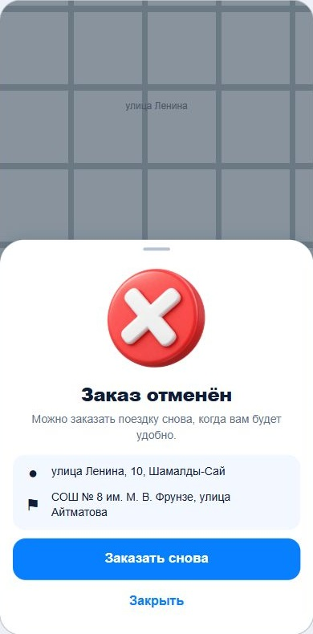
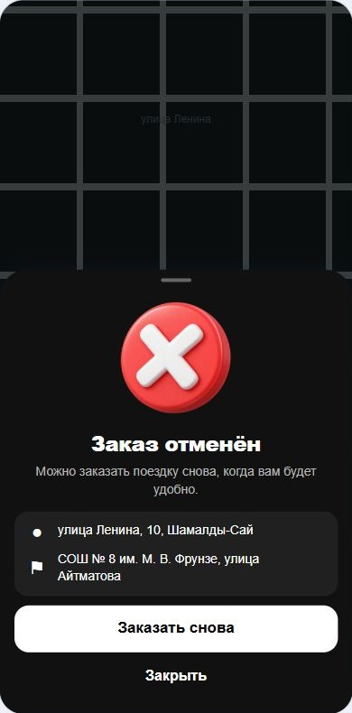
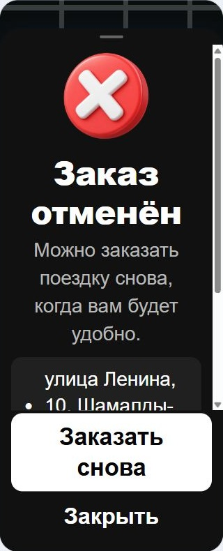

# Модалка отмены заказа — Atlas 1.2.18

После подтверждённой отмены клиент видит отдельную панель «Заказ отменён»: объёмный красный круг с белым крестиком, прежний маршрут и кнопки «Заказать снова» / «Закрыть». Оформление повторяет панель успешного завершения заказа. Общая панель поездки и её окно подтверждения отмены больше не остаются под конечным состоянием.

## Поведение

- `CANCELLED` показывает отмену; `NO_DRIVER` показывает отсутствие свободных водителей; `COMPLETED` сохраняет существующее завершение с оценкой. В интерфейсе эти состояния разделены явно. Ответ сервера остаётся источником статуса.
- «Заказать снова» закрывает старый заказ, восстанавливает его реальные адреса и выбранный сервис, сбрасывает старый расчёт и ключ заказа. Следующий заказ требует нового расчёта и подтверждения. Начальная точка отмечается как выбранная вручную, чтобы геолокация не перезаписала её.
- «Закрыть», нажатие на затемнение, кнопка назад Android и завершённый свайп вниз закрывают старый заказ и очищают маршрут.
- Кнопки блокируются во время занятого состояния и закрытия; повторное нажатие не повторяет действие. Старый идентификатор заказа помечается закрытым, поэтому фоновая синхронизация не возвращает его панель.
- Поддерживаются светлая/тёмная темы, русский/кыргызский языки, такси и обычная/грузовая доставка. Содержимое прокручивается при крупном тексте, кнопки закреплены снизу.
- Панель использует существующий `useSheetDragToClose`: появление снизу, выход вниз, жест на верхнем маркере, учёт системного уменьшения движения. Новых библиотек анимации нет.

## Иллюстрация

Создана встроенным `image_gen` по уточнению пользователя: только красная круглая 3D-иконка с белым крестиком. Запрос сохранён в `designe/order-cancellation/PROMPT.md`. Исходный прозрачный PNG — `mobile/assets/order-cancelled-red-3d.png`; используемый в приложении WebP — `mobile/assets/order-cancelled-red-3d.webp`, 512 × 512, 27 816 байт. Ранний вариант с указателем местоположения сохранён отдельно и в приложение не подключён.

## Проверки

- 127 проверок `test:booking` прошли: компоненты панелей, отмена из подтверждения, различие конечных статусов, локализация и темы, закрытие и повторный заказ, защита от повторных нажатий, аппаратная кнопка назад, жест и переходы панелей. Новые проверки включены в обычную команду этого набора.
- Дополнительный набор из 102 проверок конечных панелей, версий, вариантов приложения и обновления уведомлений прошёл. TypeScript прошёл без ошибок.
- Проверены реальные React-компоненты в браузерном адаптере React Native: обе темы на ширине 390, ширина 320 с текстом 200%, кыргызский перевод, два действия кнопок и сообщение `NO_DRIVER`. При крупном тексте кнопки видны, тело прокручивается.
- Адаптер использует настоящий компонент, его стили и иллюстрацию; карта схематична, а нативные жесты и анимация заменены для проверки оформления. Эти изображения не являются снимками с Android. Плавность и взаимодействие на физическом телефоне ещё не проверены. Реальные заказы для проверки не создавались.
- Проверка React-компонентов: хуки вызываются до возвратов по статусу; слушатель назад удаляется; действие и защита от повтора хранятся в ссылках; движение выполняет общий хук, без обновления React на каждом кадре; иллюстрация встроена и не загружается из сети; кнопки имеют локализованные названия и доступное состояние.

## Выпуск

Версия обоих приложений — 1.2.18, Android versionCode 130, архитектура arm64-v8a. Исправления названий улиц и кнопок водительских уведомлений входят в этот выпуск. Сервер менять не требуется.

Обе сборки завершились успешно. В APK проверены конечная модалка, точная копия WebP-иллюстрации, рабочий адрес API, раздельные пакеты и EAS projectId, архитектура и сохранённая служба кнопок уведомлений.

- Клиент: `mobile/builds/Atlas-client-1.2.18-arm64.apk`, пакет `atlas.kg`, 95 136 762 байта, SHA-256 `b4a4bd33a77c2762c4bc2189c2f6488e5f0c1151c72d1f085bd86711a0d84026`.
- Водитель: `mobile/builds/Atlas-driver-1.2.18-arm64.apk`, пакет `atlas.pro`, 95 136 638 байт, SHA-256 `64c37048065f64932e395c9c5c0abb29958da94165bc2a3afcda4bfb25610522`.

Подпись обоих APK проверена; SHA-256 сертификата совпадает с предыдущим выпуском: `fac61745dc0903786fb9ede62a962b399f7348f0bb6f899b8332667591033b9c`. Рабочий API — `https://api-production-47be.up.railway.app/api`.

Логи: `.local/order-cancellation-booking-tests.log`, `.local/order-cancellation-modal-tests.log`, `.local/order-cancel-driver-build.log`, `.local/order-cancel-client-build.log`, `.local/order-cancel-apk-verification.log`. Временные браузерная страница и её сервер закрыты.
